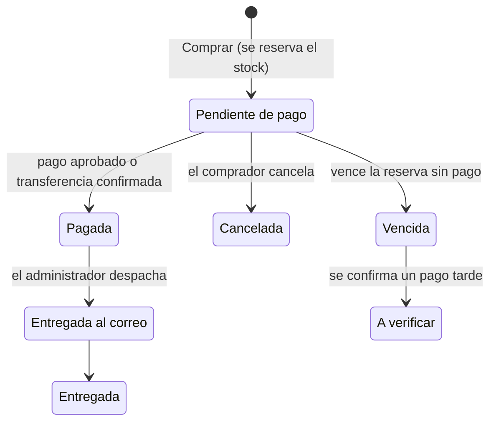

# SPEC — FAV Tienda Online

> **Versión 0.5 (borrador para la Entrega 1)** · 08/10/2026 · Documento vivo: se actualiza con cada decisión.
>
> Convenciones: **[?]** pendiente de definir · **[propuesta]** sugerido por el equipo, sin confirmar con el cliente · ~~tachado~~ descartado, se conserva el número para no romper referencias.

---

## 1. Propósito

FAV es una tienda física de ropa. Hoy vende solo en el local y lleva el stock en un Excel que no está actualizado. Este sistema agrega la venta online, unifica el control del stock del local y de la web, y registra todas las ventas.

En este documento, **el cliente** es FAV, para quien se construye el sistema, y **el comprador** es quien compra en la tienda.

El proyecto tiene un doble objetivo: cumplir el Trabajo Práctico Integrador de Arquitectura de Software 2026 y que el resultado le sirva al cliente en la vida real.

## 2. Alcance de la versión 1

### Dentro del alcance
- Catálogo de productos con variantes (talle y color), fotos, categorías, precios y promociones.
- Stock separado en **online** y **físico** por variante, con ingresos, ajustes y transferencias entre canales.
- Búsqueda de productos con filtros, orden y paginación.
- Compra online con o sin cuenta, pagando con Mercado Pago o transferencia, con reserva temporal del stock.
- Seguimiento del pedido con estados visibles para el comprador registrado, actualizados a mano por el administrador. El comprador sin cuenta se entera por mail (RN-24).
- Registro de las ventas del local (efectivo, transferencia o Mercado Pago).
- Panel de administración: productos, precios y promociones, stock, ventas y estados, y variantes con poco stock.
- Mails al comprador y al administrador.
- Usuarios con roles de comprador y administrador.

### Fuera del alcance
| Qué | Motivo |
|---|---|
| Envíos: datos de envío, costos e integración con Correo Argentino | Se implementan en una etapa posterior a esta materia. En v1 la entrega se acuerda con el vendedor (RN-16). |
| Cambios, devoluciones y saldo a favor | Se gestionan por mail o teléfono. La política del cliente se publica como página informativa (RN-21). |
| Reclamos | Se gestionan por mail o teléfono (RN-21). |
| Promociones 2x1 y promociones bancarias | No entran en v1 (RN-05). |
| Pagos con tarjeta y bancos | No entran en v1. Es una evolución futura: el medio de pago se modela como un dato que pueda ampliarse. |
| Facturación | Hoy el cliente no factura. Posible evolución futura |
| Alerta de poco stock por mail | Reemplazada por un filtro en el panel (HU-09). |
| Mails de promociones | Descartados (HU-22). |

## 3. Contexto de uso (según el cliente)

- **Volumen:** entre 10 y 20 prendas por semana, según temporada.
- **Picos:** cambio de temporada y todo diciembre.
- **Mercadería nueva:** suele estar activa primero en el local y unos días después en la web.
- **Pérdidas y fallas:** pueden ocurrir y obligan a corregir el stock a mano.
- **Medios de pago hoy:** efectivo y transferencia. En el local, pagando en efectivo puede haber un porcentaje de descuento.
- **Mercado Pago:** el cliente todavía no tiene cuenta de vendedor. Para el TP se usan credenciales de prueba.
- **Usuarios:** por ahora el sistema lo administra una sola persona.

## 4. Actores

| Actor | Descripción |
|---|---|
| Comprador registrado | Tiene cuenta y puede consultar sus compras. |
| Comprador invitado | Compra sin cuenta, con el email como mínimo. Se entera del estado de su pedido por mail o consultando al local (RN-11, RN-24). |
| Administrador | Rol de gestión que usa el cliente. Único rol de administración (RN-23). |
| Mercado Pago | Sistema externo que procesa los pagos online y avisa el resultado. |
| Sistema | Procesos automáticos: vencimiento de reservas y envío de mails. |

## 5. Glosario

| Término | Significado |
|---|---|
| Cliente | FAV, el negocio para el que se construye el sistema. |
| Comprador | Persona que compra en la tienda, con o sin cuenta. |
| Producto | Prenda o artículo del catálogo, con nombre, categoría, fotos y precio base. |
| Variante | Combinación de talle y color de un producto. Es la unidad que tiene stock. |
| Canal | Dónde se vende y de dónde sale el stock: **online** o **físico** (local). |
| Stock disponible | Unidades de una variante en un canal, menos las reservadas. |
| Reserva | Unidades apartadas para una compra en curso, con vencimiento. |
| Transferencia de stock | Movimiento de unidades de una variante de un canal al otro. No es una transferencia bancaria. |
| Venta | Compra online o venta del local, con su canal, monto y medio de pago. |
| Medio de pago | Mercado Pago, transferencia bancaria o efectivo. |

## 6. Reglas de negocio

| ID | Regla | Origen / estado |
|---|---|---|
| RN-01 | Un producto tiene una o más variantes (talle + color). Cada variante tiene stock online y stock físico separados. | Equipo |
| RN-02 | Cada producto usa **un solo sistema de talles**: letras (XS, S, M, L, XL, XXL), numérico par (32, 34, 36, 38, 40, 42, 44, 46), numérico de 1 a 4 (1, 2, 3, 4) o talle único. Solo se aceptan valores del sistema elegido. | Equipo. Amplía lo indicado por el cliente (S–XL y 34–44) |
| RN-03 | Un producto puede tener varias fotos, opcionalmente asociadas a un color. | Cliente |
| RN-04 | Un producto puede estar publicado o no online, sin importar su stock. | Equipo |
| RN-05 | Las promociones se gestionan aparte del precio base. En v1 hay dos tipos: (a) descuento porcentual y (b) descuento por medio de pago (por ejemplo, un porcentaje pagando en efectivo). Toda promoción tiene fecha de inicio y de fin. Valen online y en el local. Fuera de v1: 2x1 y promociones bancarias. | Cliente + equipo. **[?]** alcance (producto, categoría o toda la tienda) y si se acumulan |
| RN-06 | Una compra online usa solo el stock online. Una venta del local usa solo el stock físico. La venta del local no se bloquea si el stock físico registrado es insuficiente: se registra igual y el stock físico de esa variante puede quedar en negativo (RN-25). | Equipo |
| RN-07 | Al pasar a pagar se reservan las unidades. Las unidades reservadas no están disponibles para nadie más. | Equipo |
| RN-08 | La reserva de una compra con Mercado Pago se libera a los 20 minutos o por cancelación explícita. Cerrar la sesión no libera la reserva porque no es detectable. | Equipo |
| RN-09 | La reserva de una compra por transferencia dura hasta 48 horas o hasta que el administrador confirme el pago. Pasado ese plazo se libera. | Cliente |
| RN-10 | Una transferencia de stock no puede mover más unidades que las disponibles (sin contar las reservadas). Queda registrada: quién, cuándo, cuánto, origen y destino. | Equipo |
| RN-11 | La compra sin cuenta exige como mínimo el email. Los datos de envío se incorporan cuando se implementen los envíos (RN-16). | Cliente + equipo |
| RN-12 | Toda venta registra canal, monto cobrado y medio de pago. | Equipo |
| RN-13 | No hay mínimo ni máximo de unidades ni de monto por compra. | Equipo |
| RN-14 | Si una transferencia se confirma cuando la reserva ya venció, la venta no se confirma sola: pasa a *A verificar* y el administrador recibe un aviso. Se aplica lo mismo a un pago de Mercado Pago aprobado con la reserva vencida. | Cliente (transferencia). **[propuesta]** (Mercado Pago). **[?]** cómo se resuelve |
| ~~RN-15~~ | ~~Solo reciben promociones por mail quienes las aceptaron.~~ | Descartada junto con HU-22 |
| RN-16 | Los envíos se implementan en una etapa posterior. En v1 la entrega se acuerda con el vendedor: el sistema no pide datos de envío, no calcula costos ni se integra con el correo. | Cliente |
| RN-17 | Las categorías son una lista fija: tops, bodys, remeras, buzos, camperas, jeans, pantalones, polleras, shorts, vestidos, conjuntos, abanicos y accesorios. | Equipo. **[propuesta]** una categoría por producto |
| RN-18 | Medios de pago por canal. **Online:** Mercado Pago o transferencia. **Local:** efectivo, transferencia o Mercado Pago. En el local el cobro ocurre fuera del sistema, que solo registra el medio usado. | Cliente + equipo. **[propuesta]** que el cobro con Mercado Pago en el local sea solo un registro |
| RN-19 | La venta online pasa por: *Pendiente de pago → Pagada → Entregada al correo → Entregada*. Los estados son visibles para el comprador. Los pasos posteriores al pago los actualiza el administrador a mano. Otros finales: *Cancelada*, *Vencida* y *A verificar*. | Cliente + equipo |
| RN-20 | El comprador solo puede cancelar una compra pendiente de pago. Después del pago, cualquier cambio se gestiona por mail o teléfono. | Cliente |
| RN-21 | El sistema no gestiona cambios, devoluciones, saldo a favor ni reclamos. La política de cambios y devoluciones del cliente y los datos de contacto se publican como página informativa. | Cliente + equipo. **[?]** datos de contacto |
| RN-22 | En la venta online el precio lo calcula el servidor al comprar y el comprador no puede modificarlo. En la venta del local el sistema sugiere el monto con la promoción vigente para el medio de pago, y el administrador registra el monto efectivamente cobrado. | Equipo |
| RN-23 | Hay un único rol de administración. En v1 se usa una sola cuenta de administrador. | Cliente |
| RN-24 | El comprador sin cuenta no consulta el estado en el sitio: se entera por los mails de compra realizada y de pedido despachado, y para cualquier otra consulta se comunica con el local. No hay número de seguimiento en v1: el seguimiento del envío llega con la integración de envíos (RN-16). | Cliente |
| RN-25 | Si el stock físico de una variante queda en negativo, el sistema la marca como *stock a corregir*. El administrador la ve en un filtro del panel (sin mail) y la corrige con un ajuste de stock (HU-08). El stock físico negativo no afecta al stock online ni a las compras de la web. | Equipo |

## 7. Estados de la venta online

- El vencimiento depende del medio de pago: 20 minutos con Mercado Pago y 48 horas con transferencia (RN-08, RN-09).
- La resolución de una venta *A verificar* es manual. **[?]** cómo se resuelve (reintegro o reasignación).
- "Pedido listo" no es un estado aparte: se informa junto con el despacho (HU-20).
- Las ventas del local se registran directamente y no tienen estados.

---

## 8. Historias de usuario y criterios de aceptación

### Catálogo

**HU-01 · Ver productos publicados.** Como comprador quiero ver los productos publicados con sus fotos, talles, colores y precio, para elegir qué comprar. *(RN-01, RN-03, RN-04, RN-05, RN-17)*
1. Dado un producto publicado, cuando el comprador entra al catálogo, entonces ve nombre, categoría, fotos, precio y los talles y colores de sus variantes.
2. Dado un producto no publicado, cuando el comprador navega o busca, entonces no aparece.
3. Dada una variante sin stock online disponible, entonces se muestra como "sin stock" y no se puede agregar al carrito.
4. Dado un producto con una promoción vigente, entonces se muestra el precio original y el precio con promoción. **[?]** cómo se muestra una promoción condicionada al medio de pago.

**HU-02 · Buscar, filtrar y ordenar.** Como comprador quiero buscar y filtrar productos, para encontrar rápido lo que busco. *(RN-02, RN-17)*
1. Cuando el comprador busca por texto, entonces obtiene los productos publicados cuyo nombre o descripción coinciden.
2. Cuando filtra por categoría, talle, color o rango de precio, entonces solo ve productos que cumplen todos los filtros aplicados.
3. Cuando ordena por precio (ascendente o descendente) o por novedad, entonces los resultados respetan ese orden.
4. Dados más resultados que el tamaño de página, cuando pasa de página, entonces no hay resultados repetidos ni salteados.
5. Dado un cambio en un producto o en su stock, cuando pasa el retraso máximo definido, entonces la búsqueda lo refleja. **[?]** el retraso máximo se define en el D6.

**HU-03 · Alta y edición de productos (admin).** Como administrador quiero cargar y editar productos con sus variantes y fotos, para mantener la tienda actualizada. *(RN-01, RN-02, RN-03, RN-17)*
1. Dado un producto nuevo, entonces queda no publicado por defecto. **[propuesta]**
2. Cuando se carga un talle que no pertenece al sistema de talles del producto, entonces se rechaza.
3. Dado un producto de talle único, cuando se intenta cargar una segunda variante de talle para el mismo color, entonces se rechaza.
4. Cuando se crean dos variantes con el mismo talle y color, entonces se rechaza.
5. Cuando se asocian fotos a un color, entonces la ficha muestra esas fotos al elegirlo.
6. Cuando se crea una variante, entonces queda registrada en Inventario con stock 0 en ambos canales.

**HU-04 · Publicar y despublicar.** Como administrador quiero decidir qué productos se ven en la web. *(RN-04)*
1. Cuando publica un producto, entonces aparece en el catálogo y en la búsqueda.
2. Cuando lo despublica, entonces deja de aparecer, sin cambiar su stock ni sus ventas anteriores.
3. Dada una reserva en curso de un producto que se despublica, entonces la reserva sigue su curso. **[propuesta]**

**HU-05 · Gestionar precios y promociones (admin).** Como administrador quiero manejar precios y promociones por separado, para hacer ofertas sin tocar el producto. *(RN-05, RN-22)*
1. Cuando cambia el precio base, entonces las compras nuevas usan el precio nuevo y las ventas ya registradas conservan el suyo.
2. Cuando crea una promoción sin fecha de inicio o de fin, entonces se rechaza.
3. Dada una promoción fuera de su vigencia, entonces no se aplica.
4. Dada una promoción por medio de pago, entonces solo se aplica a ventas que usan ese medio.
5. Dada una promoción vigente, entonces se aplica tanto online como en el local.
6. **[?]** alcance de la promoción (producto, categoría o toda la tienda) y acumulación.

### Inventario

**HU-06 · Ingreso de mercadería (admin).** Como administrador quiero cargar mercadería nueva a un canal, para reemplazar el Excel. *(RN-01, RN-06)*
1. Cuando carga N unidades de una variante en un canal, entonces el stock de ese canal aumenta en N y queda un movimiento "ingreso" con fecha y usuario.
2. Cuando carga una cantidad menor o igual a 0, entonces se rechaza.

**HU-07 · Transferir stock entre canales (admin).** Como administrador quiero mover unidades entre el stock online y el físico, para acomodar la ropa según dónde se vende. *(RN-10 · CU-03)*
1. Dadas 5 unidades disponibles online, cuando transfiere 3 al físico, entonces quedan 2 online y el físico suma 3, en una sola operación.
2. Dadas 5 unidades online con 2 reservadas, cuando intenta transferir 4, entonces se rechaza porque solo hay 3 disponibles.
3. Cuando el origen y el destino son el mismo, entonces se rechaza.
4. Dada una transferencia enviada dos veces con la misma clave, entonces se aplica una sola vez.
5. Dadas una transferencia y una reserva simultáneas sobre las últimas unidades, entonces el stock nunca queda negativo y solo una de las dos operaciones usa esas unidades.
6. Toda transferencia queda registrada con usuario, fecha, cantidad, origen y destino.

**HU-08 · Ajustar stock (admin).** Como administrador quiero corregir el stock por pérdidas o fallas. *(RN-01)*
1. Cuando ajusta el stock con un motivo, entonces se aplica y queda registrado.
2. Cuando no indica un motivo, entonces se rechaza. **[propuesta]**
3. Cuando el ajuste dejaría el stock por debajo de lo reservado, entonces se rechaza.

**HU-09 · Ver variantes con poco stock (admin).** Como administrador quiero filtrar las variantes con poco stock en el panel, para saber qué reponer, sin recibir mails. *(RN-01)*
1. Cuando activa el filtro, entonces ve los productos cuyo stock disponible (sin reservas) es menor o igual al umbral, en el canal elegido.
2. Los productos agotados se incluyen.
3. Cada fila muestra producto, talle y stock disponible.
4. Solo es accesible con el rol de administrador.
5. Umbral por categoria (no por prenda o global) del stock online.
6. **[?]** de dónde salen nombre, talle y color, porque Inventario solo conoce el identificador de la variante (D1/D5).
7. Hay un segundo filtro, *stock a corregir*, que muestra las variantes con stock físico negativo (RN-25).

### Compra online

**HU-10 · Carrito.** Como comprador quiero agregar prendas a un carrito, para comprar varias juntas. *(RN-07)*
1. Cuando agrega una variante, entonces queda en el carrito sin reservar stock.
2. Cuando pide más unidades que el stock online disponible, entonces ve un aviso.
3. Dado un producto despublicado o sin stock en el carrito, cuando va a comprar, entonces se le avisa y no puede comprarlo.

**HU-11 · Comprar con Mercado Pago.** Como comprador, registrado o invitado, quiero pagar con Mercado Pago, para comprar sin ir al local. *(RN-06, RN-07, RN-08, RN-11, RN-14, RN-18 · CU-01)*
1. Cuando aprieta "Comprar", entonces las unidades quedan reservadas por 20 minutos y se crea la venta en *Pendiente de pago*.
2. Dado un invitado sin email, cuando intenta comprar, entonces no puede continuar.
3. Cuando Mercado Pago aprueba el pago dentro de los 20 minutos, entonces la venta pasa a *Pagada*, el stock se descuenta definitivamente y se envían los mails.
4. Cuando el pago es rechazado, entonces la reserva se libera.
5. Cuando pasan 20 minutos sin pago, entonces la reserva se libera y la venta pasa a *Vencida*.
6. Dado un aviso de pago repetido, entonces la venta no se confirma dos veces ni descuenta dos veces.
7. Dado un pago aprobado con la reserva ya vencida, entonces la venta queda *A verificar* y el administrador recibe un aviso. **[propuesta]**
8. Dado un reintento de "Comprar" por un error de red, entonces no se crean dos ventas ni dos reservas.
9. Dado que Inventario no responde, cuando aprieta "Comprar", entonces ve un error claro y no queda ninguna venta a medias.

**HU-12 · Comprar con transferencia.** Como comprador quiero pagar por transferencia y que me aparten la prenda mientras pago. *(RN-09, RN-18 · CU-02)*
1. Cuando elige transferencia, entonces la reserva dura hasta 48 horas, la venta queda en *Pendiente de pago* y ve los datos para transferir. Faltan alias/cbu del cliente.
2. Cuando pasan 48 horas sin confirmación, entonces la reserva se libera y la venta pasa a *Vencida*.
3. Cuando se crea la venta, entonces el administrador recibe un mail de transferencia pendiente.

**HU-13 · Cancelar una compra pendiente.** Como comprador quiero cancelar una compra que aún no pagué, para liberar lo reservado. *(RN-20)*
1. Dada una venta *Pendiente de pago*, cuando el comprador la cancela, entonces la reserva se libera y la venta pasa a *Cancelada*.
2. Dada una venta *Pagada*, cuando intenta cancelarla, entonces no puede. Debe contactar al cliente por mail o teléfono.

**HU-14 · Ver mis compras.** Como comprador registrado quiero ver mis compras y su estado. *(RN-19)*
1. Dado un comprador registrado, cuando entra a "Mis compras", entonces ve solo las suyas con su estado actual.
2. Dado un comprador sin sesión, cuando intenta acceder, entonces se le pide iniciar sesión.

**HU-15 · Confirmar una transferencia (admin).** Como administrador quiero confirmar que llegó la transferencia, para cerrar esa venta. *(RN-09, RN-14 · CU-02)*
1. Dada una venta pendiente con la reserva vigente, cuando confirma, entonces pasa a *Pagada*, se descuenta el stock y se envían los mails.
2. Dada una venta *Vencida*, cuando confirma la transferencia, entonces la venta pasa a *A verificar*.
3. Dada una confirmación hecha dos veces, entonces se aplica una sola vez.

**HU-16 · Ver ventas por estado (admin).** Como administrador quiero ver las ventas por estado, para saber qué preparar. *(RN-19)*
1. Cuando filtra por estado, entonces ve las ventas de ese estado con fecha, comprador, canal y monto.

**HU-23 · Actualizar el estado del pedido (admin).** Como administrador quiero avanzar el estado de un pedido pagado, para que el comprador sepa dónde está. *(RN-16, RN-19)*
1. Dada una venta *Pagada*, cuando el administrador avanza el estado, entonces pasa a *Entregada al correo* y después a *Entregada*, en ese orden.
2. Cuando intenta saltar un estado o retroceder, entonces se rechaza. **[propuesta]**
3. Cuando el estado cambia, entonces el comprador lo ve en su pedido.

~~**HU-25 · Seguir un pedido sin cuenta.**~~ **Descartada.** No hay número de seguimiento en v1: el comprador sin cuenta se informa por mail o consultando al local (RN-24).

### Ventas del local

**HU-17 · Registrar una venta del local (admin).** Como administrador quiero registrar cada venta del local con lo que cobré y cómo, para que descuente el stock físico y quede registrada. *(RN-06, RN-12, RN-18, RN-22 · CU-04)*
1. Cuando registra variantes, monto y medio de pago, entonces la venta queda con canal *local* y se descuenta el stock físico.
2. Una venta del local nunca modifica el stock online.
3. El sistema sugiere el monto con la promoción vigente para el medio de pago, y el administrador puede registrar un monto distinto.
4. Dado un medio de pago distinto de efectivo, transferencia o Mercado Pago, entonces se rechaza.
5. Si falta el monto o el medio de pago, entonces se rechaza.
6. Dada una variante sin stock físico registrado suficiente (por un error de carga, pero con la prenda en el local), cuando registra la venta, entonces se registra igual, el stock físico queda en negativo y la variante se marca como *stock a corregir* (RN-25). La venta nunca se bloquea por esto.

### Usuarios

**HU-18 · Registro e inicio de sesión.** Como comprador quiero registrarme e iniciar sesión, para ver mis compras.
1. Cuando se registra con un email que ya existe, entonces se rechaza.
2. Las contraseñas se guardan con hash y nunca se devuelven en ninguna respuesta.
3. Cuando inicia sesión con datos correctos, entonces recibe un token. Con datos incorrectos recibe un error genérico que no revela si el email existe.
4. Dado un invitado que compró con un email, cuando después se registra con ese email, entonces ve esas compras. **[propuesta]**

**HU-19 · Acceso de administración.** Como administrador quiero que las funciones de administración solo se accedan con el rol de administrador. *(RN-23)*
1. Dado un usuario con rol comprador, cuando llama a una operación de administración, entonces recibe "no autorizado".
2. Dado un pedido sin token o con un token vencido, cuando accede a una ruta protegida, entonces el gateway lo rechaza.

### Mails (enviados desde Ventas)

**HU-20 · Mails al comprador.** Como comprador quiero recibir mails sobre mi compra. *(RN-19, RN-24)*
1. Cuando se crea la venta, entonces recibe un mail de compra realizada.
2. Cuando la venta pasa a *Pagada*, entonces recibe un mail de pago aprobado.
3. Cuando la venta pasa a *Entregada al correo*, entonces recibe un mail de pedido despachado.
4. Dado un evento duplicado, entonces no se reenvía el mail, salvo en la ventana de falla entre el envío y su registro (limitación a documentar en D5).
5. Dado que el servidor de mail falla, entonces se reintenta y, agotados los intentos, el mail queda registrado como fallido sin afectar la venta.

**HU-21 · Mails al administrador.** Como administrador quiero enterarme de las ventas y de lo que está pendiente.
1. Cuando una venta pasa a *Pagada*, entonces recibe un mail de venta nueva. **[propuesta]** en ese momento.
2. Cuando se crea una venta por transferencia, entonces recibe un mail de transferencia pendiente de confirmar.
3. Cuando una venta queda *A verificar*, entonces recibe un aviso.

~~**HU-22 · Mails de promociones.**~~ **Fuera de alcance.** Necesitaba datos de Usuarios y de Catálogo y complicaba la integración. Se reabre solo si se resuelve qué servicio los origina.

### Información

**HU-24 · Ver la política de cambios y los datos de contacto.** Como comprador quiero consultar la política de cambios y devoluciones y cómo contactar al cliente. *(RN-21)*
1. La página es accesible sin iniciar sesión.
2. Muestra la política de cambios y devoluciones, con el texto que proporcione el cliente.
3. Muestra los datos de contacto para cambios, devoluciones y reclamos. **[?]** mail y teléfono.

---

## 9. Casos de uso críticos

### CU-01 · Comprar online con Mercado Pago *(HU-11)*
**Precondición:** hay stock online disponible de cada variante del carrito.

**Flujo principal**
1. El comprador, registrado o invitado, revisa el carrito y aprieta "Comprar".
2. Completa sus datos (como mínimo el email, RN-11) y elige Mercado Pago.
3. Ventas obtiene de Catálogo el precio vigente de cada variante. **[propuesta]**
4. Ventas crea la venta en *Pendiente de pago*, con una clave de idempotencia.
5. Ventas le pide a Inventario reservar las unidades por 20 minutos (llamada síncrona, con timeout).
6. Ventas crea el pago en Mercado Pago y redirige al comprador.
7. Mercado Pago avisa que el pago fue aprobado.
8. Ventas pasa la venta a *Pagada* y publica `VentaPagada`.
9. Inventario convierte la reserva en descuento definitivo.
10. Ventas envía los mails.

**Flujos alternativos**
- **5a.** No hay stock suficiente: se rechaza y el comprador ve "sin stock".
- **5b.** Inventario no responde: timeout, reintento acotado y error claro al comprador. No queda una reserva a medias.
- **7a.** El pago es rechazado: se libera la reserva.
- **7b.** No llega aviso en 20 minutos: la reserva vence, Inventario publica `ReservaVencida` y la venta pasa a *Vencida*.
- **7c.** El pago llega con la reserva vencida: la venta queda *A verificar* (RN-14).
- **7d.** El aviso de Mercado Pago llega duplicado: se procesa una sola vez.

### CU-02 · Comprar con transferencia y confirmar *(HU-12, HU-15)*
**Flujo principal**
1. Igual que CU-01 hasta el paso 5, con una reserva de 48 horas y datos para transferir. La venta queda *Pendiente de pago*.
2. El administrador recibe un mail de transferencia pendiente.
3. Cuando verifica el dinero, confirma la venta.
4. Sigue como los pasos 8 a 10 de CU-01.

**Flujos alternativos**
- **a.** Vencen las 48 horas sin confirmación: la venta pasa a *Vencida*.
- **b.** La confirmación coincide con el vencimiento: gana una sola operación.
- **c.** La transferencia se confirma con la venta ya *Vencida*: pasa a *A verificar* y el administrador recibe un aviso (RN-14).

### CU-03 · Transferir stock entre canales *(HU-07)*
**Flujo principal**
1. El administrador elige variante, origen, destino y cantidad.
2. Inventario valida contra lo disponible, sin contar las reservadas.
3. En una sola transacción resta del origen, suma al destino y registra el movimiento.

**Flujos alternativos**
- **a.** Stock insuficiente: se rechaza.
- **b.** Reserva concurrente: la actualización condicional deja que gane una sola de las dos operaciones.
- **c.** Reenvío o doble clic: la clave de idempotencia evita transferir dos veces.

### CU-04 · Registrar una venta del local *(HU-17)*
**Flujo principal**
1. El administrador carga las variantes y el medio de pago (efectivo, transferencia o Mercado Pago).
2. El sistema sugiere el monto con la promoción vigente y el administrador registra el monto cobrado.
3. Ventas registra la venta con canal *local*.
4. Inventario descuenta el stock físico de forma inmediata, sin reserva.

**Flujo alternativo**
- **a.** El stock físico registrado de una variante es insuficiente: la venta se registra igual, el stock físico queda en negativo y la variante se marca como *stock a corregir* (RN-25). El flujo continúa normalmente.

---

## 10. Requisitos no funcionales

| ID | Requisito | Cómo se verifica | Origen |
|---|---|---|---|
| RNF-01 | **Resiliencia:** si un servicio o una dependencia falla, el resto del sistema sigue funcionando y el usuario ve un mensaje claro de lo que no está disponible. | Caída provocada de cada dependencia relevante, documentada en `docs/POSTMORTEM.md`. Comportamiento esperado en ARCHITECTURE.md, sección 8. | Cátedra |
| RNF-02 | **Diagnóstico:** ante una falla se puede determinar qué pasó siguiendo la operación entre servicios, sin revisar cada componente a mano. | Logs estructurados con identificador de correlación y trazas del flujo de compra. | Cátedra |
| RNF-03 | **Métricas con historial:** se mide todo (pedidos, errores por código HTTP, latencia, dependencias) y se puede consultar el pasado, por ejemplo cuántos errores 404 hubo la semana pasada, en un tablero. | Tablero con métricas históricas y al menos una alerta. **[propuesta]** retención de al menos dos semanas. | Cátedra |
| RNF-04 | **Comunicación:** toda llamada síncrona tiene timeout, manejo de errores y política de reintentos definidos. Todo mensaje asíncrono que no se puede procesar queda en una cola de mensajes fallidos. | Tests de integración y caídas provocadas. Valores en el D5. | Cátedra / consigna |
| RNF-05 | **Caché y búsqueda con herramientas existentes:** se usan bibliotecas y motores existentes, no implementaciones propias. La caché se invalida ante cambios y se mide su aprovechamiento. | Métricas de aciertos de caché antes y después (D7). | Cátedra |
| RNF-06 | **Picos de demanda:** el sistema se prueba con un escenario de pico (cambio de temporada, diciembre) y se documenta cómo se comporta y cuál es su principal límite. | Test de carga con resultados analizados (D13). | Cátedra / consigna |
| RNF-07 | **Portabilidad:** el sistema se levanta con un solo comando mediante Docker, en cualquier computadora y sin configuración manual. | Arranque en una computadora limpia siguiendo el README. | Cátedra / consigna |
| RNF-08 | **Una base de datos por servicio:** ningún servicio accede a la base de otro. | Revisión de la configuración de Docker Compose y del código. | Cátedra |

## 11. Integración con otros grupos

- **Capacidad a publicar:** se propone la reserva de stock, de Inventario. Se confirma al coordinar en clase. El contrato va en `docs/contracts/`.
- **Capacidad a consumir:** **[?]** la asigna la cátedra.

## 12. Pendientes

### Con el cliente
| Tema | Afecta a |
|---|---|
| Alcance de las promociones (producto, categoría o toda la tienda) y si se acumulan | RN-05, HU-05 |
| Cómo se resuelve una venta *A verificar* (reintegro o reasignación) | RN-14 |
| Cómo cobra con Mercado Pago en el local (fuera del sistema o desde el sistema) | RN-18 |
| Datos de contacto (mail y teléfono) | RN-21, HU-24 |
| Valor del umbral de poco stock para cada categoría | HU-09 |
| Cuántos productos piensa tener | Dimensionamiento (D13) |
| Una versión del Excel de stock, para ver la estructura | Carga inicial |

### Del equipo
| Tema | Dónde se resuelve |
|---|---|
| De dónde salen nombre, talle y color en el listado de poco stock | D1 / D5 |
| Cómo obtiene Ventas el email de un comprador registrado | D1 |
| Cómo se dispara el envío de mails sin bloquear la venta | D5 |
| Autenticación del consumidor externo de la capacidad publicada | D8 |
| Retraso máximo del índice de búsqueda | D6 |
