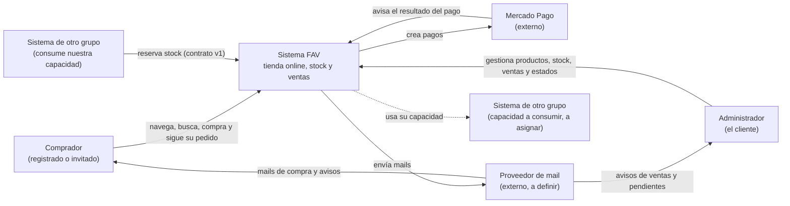
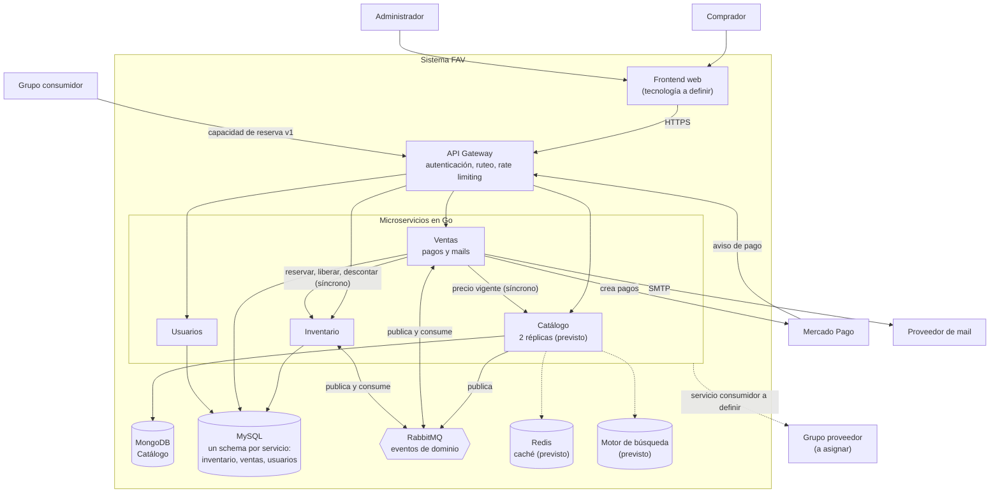

# Arquitectura — FAV Tienda Online

> **Versión 0.1 (borrador para la Entrega 1)** · 08/10/2026 · Documento vivo.
>
> Convenciones: **[?]** pendiente de definir · **[propuesta]** sugerido, a validar en el ADR correspondiente · *previsto*: forma parte del diseño pero se implementa en una entrega posterior.
>
> El alcance funcional (reglas, historias y casos de uso) está en [`SPEC.md`](../SPEC.md). Las decisiones se justifican en [`docs/adr/`](adr/).

---

## 1. Visión general

El sistema se organiza en **cuatro microservicios** detrás de un **API Gateway**, con un **frontend web** como único punto de interacción del usuario:

| Componente | Qué resuelve |
|---|---|
| **Catálogo** | Qué se vende y cómo se muestra: productos, variantes, fotos, categorías, precios y promociones. |
| **Inventario** | Cuántas unidades hay y dónde: stock online y físico, reservas, transferencias y ajustes. |
| **Ventas** | Las ventas online y del local, sus pagos (Mercado Pago y transferencia), sus estados y los mails. |
| **Usuarios** | Registro, inicio de sesión y roles (comprador y administrador). |
| **API Gateway** | Punto de entrada único: autenticación, ruteo y control de tráfico. |
| **Frontend web** | Tienda para el comprador y panel para el administrador. |

Cada servicio es dueño de sus datos y nadie accede a la base de otro: la información se obtiene por su API o por sus eventos (*Database per Service*).

## 2. Diagrama de contexto

Muestra el sistema como una caja y con quién interactúa.



Las líneas punteadas indican relaciones todavía no definidas: la capacidad a consumir la asigna la cátedra.

## 3. Diagrama de contenedores

Muestra las piezas desplegables dentro del sistema y cómo se comunican.



Las líneas punteadas son componentes o relaciones previstos o pendientes de definir.

## 4. Servicios, responsabilidades y datos

| Servicio | Responsabilidad | Datos que posee | Almacenamiento | Estilo interno (preliminar, D2) |
|---|---|---|---|---|
| Catálogo | Productos, variantes, fotos, categorías, precios base, promociones y publicación. Calcula el precio vigente. | Productos con sus variantes, promociones | MongoDB | Capas (Handler → Service → Repository). **[propuesta]** lecturas servidas por el índice de búsqueda (CQRS liviano) |
| Inventario | Stock por variante y canal, reservas con vencimiento, transferencias, ingresos, ajustes y movimientos. Expone la capacidad publicada. | Stock, reservas, movimientos, outbox, mensajes procesados | MySQL (schema `inventario`) | **[?]** a definir en el D2 |
| Ventas | Ventas online y del local, estados, número de seguimiento, pagos (Mercado Pago y transferencia) y envío de mails. | Ventas, ítems, pagos, registro de mails, outbox, mensajes procesados | MySQL (schema `ventas`) | Hexagonal **[propuesta]** |
| Usuarios | Registro, inicio de sesión, emisión del token y roles. | Usuarios, hash de contraseña, rol | MySQL (schema `usuarios`) | Capas **[propuesta]** |

### Qué no hace cada servicio
- **Catálogo** no sabe cuántas unidades hay: la disponibilidad es de Inventario.
- **Inventario** no conoce precios ni compradores: solo variantes, cantidades y canales.
- **Ventas** no modifica stock directamente: se lo pide a Inventario.
- **Usuarios** no conoce ventas: Ventas guarda la referencia al comprador.

### Por qué estos límites
Se resumen acá y se justifican en el **ADR-001 (D1)**:
- **Catálogo e Inventario están separados** porque tienen cargas y garantías distintas: el catálogo se lee mucho y tolera unos segundos de atraso; el stock no puede venderse de más ni perder unidades. Separarlos permite escalar y cachear el catálogo sin tocar el stock, y deja la reserva y la transferencia contenidas en un solo servicio.
- **Los pagos están dentro de Ventas**, como adaptador hacia Mercado Pago, porque no hay reglas de pago propias que justifiquen otro servicio.
- **No hay servicio de notificaciones:** Ventas envía los mails mediante un puerto propio. Si en el futuro hace falta, el adaptador de mail se puede extraer a un servicio sin cambiar la lógica de negocio.

## 5. Propiedad de los datos

| Dato | Dueño | Quién más lo usa y cómo |
|---|---|---|
| Producto, variante, fotos, categoría | Catálogo | Inventario conoce el identificador de la variante. Ventas guarda una copia de nombre, talle, color y precio en cada venta **[propuesta]**, para que una venta registrada conserve su precio (HU-05). |
| Precio base y promociones | Catálogo | Ventas consulta el precio vigente al momento de comprar **[propuesta]**. |
| Stock, reservas y movimientos | Inventario | Ventas reserva, libera y descuenta mediante su API. El índice de búsqueda recibe la disponibilidad online por eventos **[propuesta]**. |
| Venta, ítems, pagos, estados, número de seguimiento | Ventas | El comprador los consulta a través del gateway. |
| Usuario, credenciales y rol | Usuarios | El gateway valida el token. **[?]** cómo obtiene Ventas el email de un comprador registrado. |
| Índice de búsqueda | Modelo de lectura derivado | No es fuente de verdad: se reconstruye a partir de Catálogo e Inventario. |
| Caché | Copia temporal | No es fuente de verdad: puede estar ausente o vencida. |

**MySQL compartido con un schema por servicio [propuesta]:** una sola instancia con un schema propio para Inventario, Ventas y Usuarios, que es la variante "schema separado" de *Database per Service*. Simplifica el arranque local. La regla es que ningún servicio lee ni escribe el schema de otro. Se justifica en el **ADR-003 (D3)**.

## 6. Comunicaciones

### Síncronas (HTTP)
| Origen → destino | Para qué | Protección | Si falla |
|---|---|---|---|
| Frontend → Gateway → servicios | Todas las operaciones del usuario | Token validado en el gateway; rate limiting | Error claro en la interfaz |
| Ventas → Catálogo | Precio vigente al comprar **[propuesta]** | Timeout | No se puede iniciar la compra; error claro |
| Ventas → Inventario | Reservar, liberar y descontar stock | Timeout, reintento acotado solo ante fallas transitorias, clave de idempotencia | Error claro; no queda una venta ni una reserva a medias |
| Ventas → Mercado Pago | Crear el pago | Timeout y circuit breaker | La compra no avanza y la reserva vence sola |
| Mercado Pago → Gateway → Ventas | Aviso del resultado del pago | Procesamiento idempotente | Mercado Pago reintenta el aviso |
| Ventas → proveedor de mail | Enviar mails | Envío fuera de la transacción de la venta, con reintentos **[propuesta]** | Se registra como fallido; la venta no se afecta |
| Grupo consumidor → Gateway → Inventario | Capacidad publicada (reserva de stock) | Según el contrato en `docs/contracts/` | Errores definidos en el contrato |

Los valores concretos de timeouts y reintentos se definen en el **ADR-005 (D5)**.

### Asíncronas (RabbitMQ, con transactional outbox)
| Evento | Publica | Consume | Efecto |
|---|---|---|---|
| `VentaPagada` | Ventas | Inventario | Convierte la reserva en descuento definitivo. |
| `ReservaVencida` | Inventario | Ventas | Pasa la venta a *Vencida*. |
| `VarianteCreada` **[propuesta]** | Catálogo | Inventario | Registra la variante con stock 0 en ambos canales. |
| Cambios de producto y de stock **[propuesta]** | Catálogo e Inventario | Actualización del índice de búsqueda | Mantiene la búsqueda sincronizada (D6). |

Todos los consumidores son idempotentes y los mensajes que no se pueden procesar van a una cola de mensajes fallidos (DLQ).

## 7. Operaciones críticas

Las dos operaciones que no pueden duplicarse ni perder información (requisito 2.8) viven en **Inventario**:
- **Reserva de stock online** (CU-01, CU-02): nunca reservar más de lo disponible, ni dos veces la misma compra.
- **Transferencia entre stocks** (CU-03): restar y sumar en una sola transacción, sin quedar negativo ante operaciones concurrentes.

El tratamiento de concurrencia, duplicados y fallas parciales se detalla en el **ADR-004 (D4)**.

## 8. Distribución de los componentes

- **Local:** todo se levanta con un solo comando mediante Docker Compose: servicios, gateway, frontend, MongoDB, MySQL y RabbitMQ (más Redis y el motor de búsqueda cuando se incorporen). Los secretos van en un archivo `.env` que no se sube al repositorio.
- **Balanceo:** Catálogo con dos réplicas, porque es el servicio más leído **[propuesta]**. El mecanismo se define en el **ADR-012 (D12)**.
- **Nube:** la capacidad publicada (Inventario) se despliega con una URL pública para el grupo consumidor. **[?]** proveedor de nube.

## 9. Estructura del repositorio

```
/
├── README.md
├── SPEC.md
├── docker-compose.yml          # arranque local con un solo comando
├── .env.example                # variables necesarias, sin valores secretos
├── .gitignore                  # incluye .env
├── go.work                     # une los módulos Go para desarrollo local
├── .github/
│   └── pull_request_template.md
├── docs/
│   ├── ARCHITECTURE.md
│   ├── POSTMORTEM.md           # se completa tras la caída controlada
│   ├── adr/
│   │   ├── ADR-000-plantilla.md
│   │   ├── ADR-001-limites-de-los-servicios.md
│   │   ├── ADR-003-persistencia.md
│   │   ├── ADR-005-comunicacion.md
│   │   └── ADR-008-contrato-propio.md
│   └── contracts/
│       ├── README.md
│       └── reservas-v1.openapi.yaml
├── services/
│   ├── catalogo/
│   ├── inventario/
│   ├── ventas/
│   └── usuarios/
├── gateway/
├── frontend/
└── mocks/
    └── reservas-v1/            # mock del contrato publicado
```

**Cada servicio** tiene su propio `go.mod`, `Dockerfile` y `README.md`, y se puede construir y desplegar por separado. Su organización interna sigue el estilo del servicio, que se decide en el D2. Estas estructuras son provisorias:

```
services/catalogo/              # capas
├── cmd/catalogo/main.go
├── internal/
│   ├── handler/
│   ├── service/
│   └── repository/
├── Dockerfile
├── go.mod
└── README.md

services/ventas/                # hexagonal
├── cmd/ventas/main.go
├── internal/
│   ├── dominio/                # venta, estados y reglas, sin dependencias externas
│   ├── aplicacion/             # casos de uso
│   ├── puertos/                # interfaces que necesita el núcleo
│   └── adaptadores/            # http, mysql, mercadopago, mail, rabbitmq
├── Dockerfile
├── go.mod
└── README.md
```

**Numeración de los ADR:** el número coincide con la decisión de la consigna (ADR-001 = D1, …, ADR-013 = D13). Las decisiones adicionales empiezan en ADR-014.

## 10. Decisiones registradas

| ADR | Decisión | Estado |
|---|---|---|
| ADR-001 | D1 · Límites de los servicios | Entrega 1 |
| ADR-003 | D3 · Persistencia (versión inicial) | Entrega 1 |
| ADR-005 | D5 · Comunicación entre servicios (versión inicial) | Entrega 1 |
| ADR-008 | D8 · Contrato propio | Entrega 1 |
| ADR-002, 004, 006, 007, 009 a 013 | D2, D4, D6, D7, D9 a D13 | Entregas siguientes |

## 11. Pendientes de arquitectura

| Tema | Dónde se resuelve |
|---|---|
| Estilo interno de Inventario | D2 |
| Motor de búsqueda y retraso máximo del índice | D6 |
| Qué se cachea, invalidación y métricas | D7 |
| Tecnología del API Gateway y del frontend | D2 / D12 |
| Herramientas de observabilidad | D11 |
| De dónde salen nombre, talle y color en el listado de poco stock | D1 / D5 |
| Cómo obtiene Ventas el email de un comprador registrado | D1 |
| Autenticación del consumidor externo de la capacidad publicada | D8 |
| Dónde se almacenan las fotos de los productos | D3 |
| Dónde vive el carrito antes de comprar | D1 |
| Proveedor de mail y de nube | D5 / D13 |
| Cómo recibe el entorno local los avisos de Mercado Pago | D5 |
